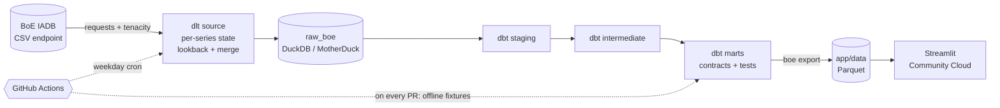

# BoE Stats Pipeline

[](https://github.com/Daudsaid/boe-stats-pipeline/actions/workflows/ci.yml)
[](https://github.com/Daudsaid/boe-stats-pipeline/actions/workflows/refresh.yml)

**Live dashboard:** _add your Streamlit Cloud URL here_

A pipeline that ingests UK monetary and market data from the **Bank of England
Interactive Database (IADB)** and models it into analysis-ready marts: every
Bank Rate decision, the daily gilt curve, a monthly macro panel, and how gilts,
sterling and mortgage rates reacted to each rate change.



## Stack

| Layer | Tool | Why |
|---|---|---|
| Ingestion | Python, **dlt**, requests, tenacity | Schema inference, merge loads and state handled by dlt; only the BoE-specific parts are hand-written |
| Warehouse | **DuckDB** locally, **MotherDuck** in prod | Zero-setup for anyone cloning the repo; same engine and SQL in the cloud |
| Transformation | **dbt-core** + dbt-duckdb | Layered models, enforced contracts, unit tests, data tests, source freshness |
| Orchestration | **GitHub Actions** | See [design decisions](#design-decisions) |
| Dashboard | **Streamlit** + Altair on Community Cloud | Reads committed Parquet: no database, no secrets, redeploys on every data refresh |
| Tooling | uv, ruff, pytest, pre-commit | Locked, reproducible environment; lint + tests gate every PR |

## Data

All series are defined in [`boe_pipeline/series.py`](boe_pipeline/series.py). Adding one is a one-line change.

| Code | Series | Frequency |
|---|---|---|
| IUDBEDR | Official Bank Rate | Daily |
| IUDSOIA | SONIA | Daily |
| IUDSNPY / IUDMNPY / IUDLNPY | 5y / 10y / 20y gilt nominal par yields | Daily |
| XUDLUSS / XUDLERS | GBP/USD, GBP/EUR spot | Daily |
| IUMBV34 / IUMB482 | Quoted 2y fixed mortgage rate, 75% / 90% LTV | Monthly |
| LPMAUYN | M4 amounts outstanding (SA, £m) | Monthly |
| LPMVQJW | M4 12-month growth rate (SA) | Monthly |

## Models

```
raw_boe.observations, raw_boe.series                 (dlt)
└── staging       stg_boe__observations, stg_boe__series
    └── intermediate  int_daily_rates_wide, int_monthly_series_wide
        └── marts     fct_bank_rate_decisions
                      fct_yield_curve_daily
                      fct_monthly_macro
                      fct_decision_market_reaction
```

| Mart | Grain | What it answers |
|---|---|---|
| `fct_bank_rate_decisions` | one row per rate change | When did Bank Rate move, by how much, after how long? |
| `fct_yield_curve_daily` | business day | Curve shape: 10y–5y and 20y–5y slopes, 10y vs Bank Rate, SONIA vs Bank Rate |
| `fct_monthly_macro` | month | Bank Rate, gilts, FX, mortgage spreads and M4 lined up on one grain |
| `fct_decision_market_reaction` | one row per rate change | 10y gilt and GBP/USD move over 5 business days; 2y fixed mortgage move over 3 months |

## Dashboard

`app/streamlit_app.py` has five tabs:
- **Bank Rate:** every change since 1975, plus hikes and cuts by decade.
- **Mortgage pass-through:** 2y fixed rates vs Bank Rate, the lender margin, and the 3-month mortgage move after each change.
- **Gilt curve:** 5/10/20y yields and the 10y–5y slope.
- **Sterling & money:** GBP/USD, GBP/EUR and M4 growth.
- **Data:** series freshness and CSV downloads.

```bash
make app        # http://localhost:8501, reads app/data/*.parquet
make export     # refresh app/data from your local warehouse
```

### Deploy on Streamlit Community Cloud

1. Push the repo to GitHub with `app/data/*.parquet` committed.
2. Go to [share.streamlit.io](https://share.streamlit.io), click **Create app**, then **Deploy a public app from GitHub**.
3. Choose this repo, branch `main`, main file path `app/streamlit_app.py`. Under **Advanced settings**, choose Python 3.12.
4. Click **Deploy**. Streamlit installs `app/requirements.txt` (streamlit, pandas, pyarrow, altair only).

The `Refresh data` workflow runs on weekday afternoons. It commits new Parquet whenever the BoE publishes, and Streamlit Cloud redeploys on that push. No secrets are needed: without `MOTHERDUCK_TOKEN`, the workflow rebuilds a throwaway DuckDB on the runner.

## Quality

- **Python tests** (`pytest`): CSV parsing, HTML/empty-response detection, retry and backoff behaviour, idempotent reloads, incremental lookback windows, and upserting revised values.
- **dbt unit tests**: decision detection and curve-spread logic, tested on hand-written inputs.
- **dbt data tests**: uniqueness of (series, date), referential integrity, accepted values, plausible-range checks per unit, every registered series has data, and no future dates.
- **Enforced contracts** on every mart, so a column type change fails the build instead of reaching consumers.
- **Source freshness** runs after every scheduled refresh.

## Quickstart

Requires [uv](https://docs.astral.sh/uv/).

```bash
make install   # deps + pre-commit hooks
make demo      # offline: synthetic fixtures -> data/boe_fixtures.duckdb -> dbt build (what CI runs)
make build     # live: Bank of England -> data/boe.duckdb -> dbt build (incremental after first run)
make rebuild   # live: drop raw tables + load state, reload all history since 1975
make export    # marts -> app/data/*.parquet
make app       # run the dashboard locally
```

Fixtures and real data live in separate files with separate dlt pipeline state, so
running the demo can never contaminate the real warehouse. The real warehouse is
`data/boe.duckdb`:

```bash
uv run python -c "import duckdb; print(duckdb.connect('data/boe.duckdb').sql('from marts.fct_bank_rate_decisions'))"
```

Other ingest options: `uv run boe ingest --help` (`--series`, `--start`, `--full-refresh`, `--target prod`).

### Production (MotherDuck)

1. Create a free MotherDuck account and a token.
2. Add it as the `MOTHERDUCK_TOKEN` repository secret.
3. The `Refresh` workflow runs on weekday afternoons, or on demand from the Actions tab, with an optional full refresh.

Locally: copy `.env.example` to `.env`, then `uv run boe ingest --target prod` and `DBT_TARGET=prod make dbt`.

## Design decisions

**No Airflow or Dagster.** The workload is a few thousand rows a day from one source. A scheduler that has to stay running would be the most complex and most fragile part of the system while adding nothing. GitHub Actions provides cron, retries, logs, secrets and failure emails for free, and the same tooling runs CI. If this grew to many sources with cross-pipeline dependencies, Dagster's asset model (with `dagster-dlt` and `dagster-dbt`) would be the next step. The ingest CLI and dbt project would plug into it unchanged.

**DuckDB over Postgres.** This is analytical work: window functions, ASOF joins and pivots over time series. DuckDB needs no server, so CI can build the entire warehouse from scratch on every PR. MotherDuck gives the hosted copy without changing a line of SQL.

**Long raw table, wide marts.** Raw data stays in `(series_code, date, value)` form, so a new series needs no schema migration. Pivoting happens in dbt, where it is tested.

**Revisions are expected.** The BoE revises recent data, monthly money statistics especially. Each run re-fetches a lookback window behind each series' high-water mark (14 days for daily series, about 13 months for monthly ones), and dlt `merge` upserts on `(series_code, date)`. Reruns are idempotent, and a test proves it.

**Correct series, correct comparisons.** Bank Rate uses the daily official rate, so rate changes land on their exact effective dates instead of smearing across monthly averages. M4 uses amounts outstanding plus the BoE's own growth rate, not computed growth on monthly flows. Quoted mortgage rates are monthly averages, so the mortgage spread is measured against the average Bank Rate.

**The IADB returns HTML with status 200 on bad requests.** The client validates the payload, not only the status code, and fails loudly on a wrong series code instead of loading nothing.

**The dashboard reads Parquet committed to the repo, not the warehouse.** The marts total about 250 KB. Committing them means the public app needs no database credentials and keeps working if the warehouse is down. The data is also versioned: `git log app/data` shows every refresh. The trade-off is the update rate. Data is as fresh as the last scheduled run, which is fine for statistics published daily or monthly.

**Data checks catch wrong series, not just broken ones.** The first live load showed the "90% LTV" mortgage series priced *below* the 75% LTV rate, with a 0% month in 2009. The code (`IUMB479`) turned out to be a 2-year *tracker*, not a fix. It was replaced with `IUMB482`. Two tests now guard against this: no mortgage rate at or below 0.25%, and a warning if 90% LTV is regularly cheaper than 75% LTV.

**Offline fixtures.** `tests/fixtures/iadb/` holds synthetic CSVs in the exact IADB format, generated by `scripts/make_fixtures.py`. Only the Bank Rate path follows the real 2024–25 decisions. The rest are seeded random walks, so they are **not real data**. They let CI exercise dlt and dbt end to end without network access.

## Project layout

```
app/                 Streamlit dashboard + the Parquet it reads (app/data, refreshed by CI)
boe_pipeline/        ingestion package (series registry, IADB client, dlt source, export, CLI)
dbt/                 dbt project (profiles.yml committed: env vars only, no secrets)
tests/               pytest suite + IADB-format fixtures
scripts/             fixture generator
.github/workflows/   ci.yml (every PR), refresh.yml (weekday cron -> warehouse -> app/data)
```

## Author

**Daud Abdi**, Data Engineer, London.
[GitHub](https://github.com/Daudsaid) · [LinkedIn](https://linkedin.com/in/daudabdi0506) · [Portfolio](https://daud-abdi-portfolio-site.vercel.app/)
